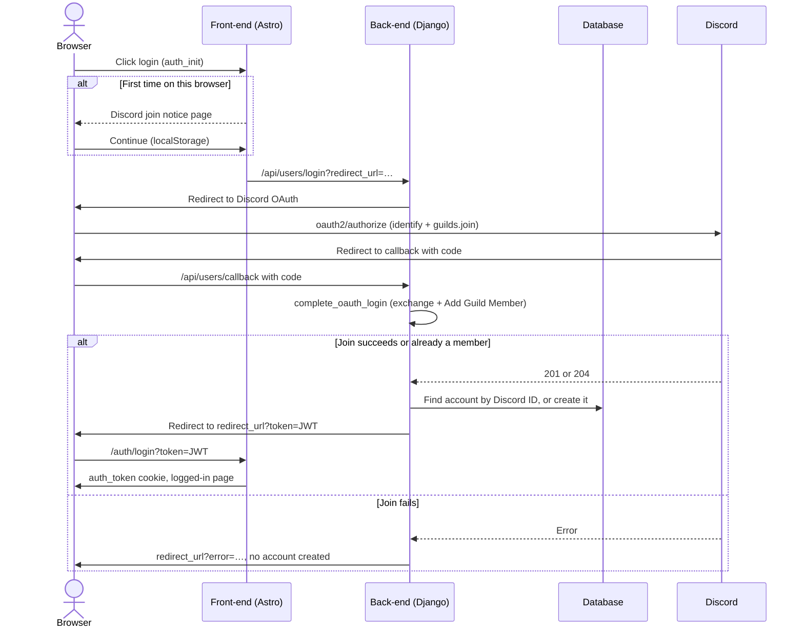

# Authentication

Authentication answers "who are you?" Every login ends with the backend signing a JWT and redirecting to `<redirect_url>?token=<JWT>`. Clients then send it as `Authorization: Bearer <JWT>`. There is no password login.

Access decisions (what you may do) are authorization: see [authorization.md](authorization.md).

## Login entry points

| Entry point | Used by | Identity provider | Lands on | Token |
|-------------|---------|-------------------|----------|-------|
| `GET /api/users/login?redirect_url=` → Discord → `GET /api/users/callback` | Website, desktop app | Discord OAuth (`identify` + `guilds.join`) | `redirect_url?token=` | User token (`issue_discord_user_jwt`) |
| `GET /api/users/login/eve?redirect_url=` → EVE SSO → `GET /api/users/eve/complete/` | Mobile app | EVE SSO via django-esi (`publicData`) | `redirect_url?token=` (default `mobile://auth/callback`) | Character token (`issue_eve_character_jwt`) |
| `GET /admin/login/` or `/oauth2/login/` → Discord → `/oauth2/login/redirect` | Django admin, ESI token flows on the backend | Discord OAuth | Django session cookie, no JWT | None |
| Any of the above with `FAKE_LOGIN_USER_ID` set | Local development only | None | `redirect_url?token=` (or `/admin` for the admin login) | User token for that user id (`issue_fake_login_jwt`) |

Errors come back as `redirect_url?error=<CODE>&id=<error id>` instead of `?token=`.

### Discord (website and desktop)



- **Guild membership.** `DiscordClient.complete_oauth_login` exchanges the code and calls Discord **Add Guild Member** before creating or linking a site account. "Already a member" (HTTP 204) counts as success. If the join fails, login stops and no account is created. Canceling Discord consent never reaches a successful callback.
- **Join notice.** All website login links go through `/redirects/auth_init`, a one-time notice (remembered in `localStorage`) that login adds you to Discord and that leaving Discord deletes website data.
- **Account matching is by Discord ID** (`users.helpers.make_user_objects`). An existing `DiscordUser` row with that ID picks the account, and the Django username follows the Discord username. Usernames never pick an account, because Discord releases changed usernames for others to claim. A Discord ID we haven't seen gets a new account.
- **Website.** `frontend/app/src/pages/auth/login.astro` reads `?token=`, checks it with one API call, and stores it in the `auth_token` cookie for 180 days.
- **Desktop app.** `desktop/src/main/auth.js` uses the same endpoint with a one-shot loopback listener (`http://127.0.0.1:<port>/<nonce>`) as `redirect_url`, so the token lands in the app process. The app keeps it encrypted with Electron `safeStorage` when the OS supports it.

### EVE SSO (mobile)

`GET /api/users/login/eve` sends the app through EVE SSO (`publicData` only, via django-esi's shared `/sso/callback`). `users.eve_views.eve_mobile_sso_complete` then calls `users.eve_sso.issue_mobile_jwt`:

- The token always names the character (`character_id`, `character_name`, `sub` = character id).
- When that character is linked to a site account, it also carries `user_id`, `username` and `is_superuser`, and `sub` becomes the username.
- A character-only token has no `user_id`, so `AuthBearer` endpoints reject it with 401. The mobile app reads it through `GET /api/users/session`, which decodes the token itself and returns the session fields.

### Redirect allowlist

Every login appends the token to `redirect_url`, so `users/redirects.py` only lets it point at:

- an origin from `app.cors.allowed_origins()` (`CORS_ALLOWED_ORIGINS`, or the built-in website origins), plus the `WEB_LINK_URL` origin;
- `http://` on a loopback host (`localhost`, `127.0.0.1`, `::1`), for the desktop app and local development;
- the app schemes `mobile://` and `minmatar://`;
- the Expo Go schemes `exp://` and `exps://`, only on loopback or private-network hosts (mobile development).

Anything else (other hosts, other schemes, URLs with credentials) falls back to the default: `<WEB_LINK_URL>/auth/login` for Discord logins, `mobile://auth/callback` for EVE logins. **To add a client**, add its origin to `CORS_ALLOWED_ORIGINS` or its scheme to `APP_SCHEMES` and `DeepLinkRedirect.allowed_schemes`, and extend the redirect tests in `users/tests.py`.

## Tokens

All tokens are signed and read in **`backend/users/jwt_auth.py`**, and nowhere else (`users/test_jwt_auth.py` enforces this for non-test code). They are HS256, signed with `SECRET_KEY`.

| Issuer | Claims |
|--------|--------|
| `issue_discord_user_jwt` | `user_id`, `username`, `avatar` (Discord CDN), `is_superuser`, `sub`, `iss`, `iat` |
| `issue_eve_character_jwt` | `character_id`, `character_name`, `avatar` (EVE portrait), `sub`, `iss`, `iat`; plus `user_id`, `username`, `is_superuser` when linked |
| `issue_fake_login_jwt` | `user_id`, `username`, `is_superuser`, `sub`, `iss`, `iat` |

- **No permissions or features** are in the token. They are evaluated server-side on each request. `is_superuser` is display-only: never use it for access.
- **Lifetime: tokens never expire.** There is no `exp` claim, and the backend doesn't require one. The website cookie lasts 180 days, but the token inside it stays valid after that. The desktop and mobile apps keep theirs until the user signs out.
- **Revoking.** You can't revoke a single token. A token stops working when its user is deleted (offboarding), because `AuthBearer` can no longer find the user. Rotating `SECRET_KEY` invalidates every token at once: it signs out every website, desktop and mobile session, and the bot.
- **Adding `exp` is a client change first.** The desktop app clears its stored session on any 401, and the website's account page logs out on one. Ship refresh-on-401 in the clients before any token carries `exp`. A desktop stored-session change is a major version (see `.claude/rules/desktop-release.md`).

## `AuthBearer`

`backend/authentication.py`. It validates the bearer token on Django Ninja endpoints and sets `request.user`. `AuthOptional` lets requests without a token through as `AnonymousUser`.

| Situation | Response |
|-----------|----------|
| Bad signature, malformed token | 401 |
| Valid token without `user_id` (character-only mobile token) | 401 |
| `user_id` with no matching user (deleted or offboarded) | 401 |
| Database or other server error during the lookup | 500, never a 401, so clients don't sign people out during an outage |

Rejections are logged at debug level on the `authentication` logger. Browser redirects can't send a header, so the Reddit and creator OAuth connect starts (`/api/reddit/connect`, `/api/creators/{provider}/connect`) take the token as a `?token=` query parameter and pass it to `AuthBearer().authenticate` directly.

## Service account (the Discord bot)

The bot calls the API with a long-lived user token from its `MINMATAR_API_TOKEN` setting. Locally, `make_test_user` prints one (see `docs/developer_data_seeding.md`). Endpoints and actions only the bot may perform call `authentication.require_service_account(request)` (403 otherwise) or `is_service_account(user)`:

- Discord guild sync and activity records (`discord/router.py`)
- Help-ticket bot endpoints (`help_tickets/router.py`)
- Acting for another Discord user on buyback and LP order acks and NPSI event buttons (`buyback/endpoints/purchase/post_order_discord_ack.py`, `industry/endpoints/loyalty/post_order_discord_ack.py`, `fleets/helpers/npsi_actions.py`)

**Who counts as the bot.** The bot is the user holding the **`users.service_account`** permission, granted to that user directly. It is deliberately not an `auth.Group`, because groups sync to Discord roles. Manage it with:

```bash
pipenv run python manage.py service_account --list
pipenv run python manage.py service_account --grant <user_id>
pipenv run python manage.py service_account --revoke <user_id>
```

**Shadow mode (current).** Any `is_staff` or `is_superuser` user also still passes, as before. Each such pass logs a warning on the `authentication` logger, at most once an hour per user: `Service-account check passed by staff fallback (user_id=…)`. Once the bot's user holds the permission and the log shows no other users, the staff fallback can be removed.

## Code map

| Piece | Path |
|-------|------|
| Discord login + callback, `/session` | `backend/users/router.py` |
| EVE SSO completion | `backend/users/eve_views.py`, `backend/users/eve_sso.py` |
| Redirect allowlist | `backend/users/redirects.py` |
| Account matching | `backend/users/helpers.py` (`make_user_objects`) |
| Token issue and decode | `backend/users/jwt_auth.py` |
| `AuthBearer`, service account | `backend/authentication.py` |
| Service-account command | `backend/users/management/commands/service_account.py` |
| Admin Discord login | `backend/discord/views.py` |
| Website token intake | `frontend/app/src/pages/auth/login.astro` |
| Desktop login | `desktop/src/main/auth.js` |
| Tests | `backend/users/test_jwt_auth.py`, `backend/users/tests.py` |

**EVE characters** are linked separately via ESI SSO once logged in. The **primary character** determines the user's affiliation (see [authorization.md](authorization.md)).
