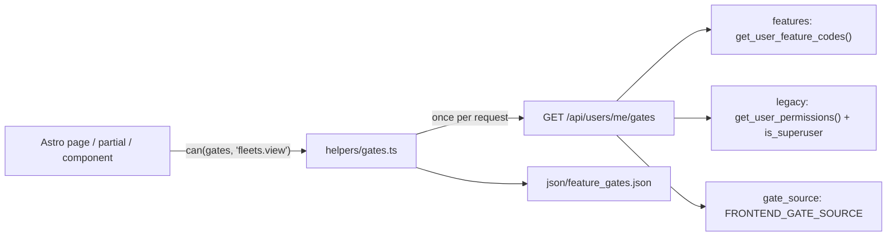

# Frontend feature gating

The site gates pages, partials, nav, tiles and buttons through **gates**. Each gate maps to a PilotFeature. A runtime switch decides whether the site acts on the feature or on the Django-permission expression the gate replaced. This lets us move frontend gating to features in steps that can each be undone, with no change for users until the switch is flipped.

This is step 3 of [migration.md](migration.md).

## How it works

### Backend

- **`GET /api/users/me/gates`** (`users/endpoints/get_me_gates.py`, `AuthBearer`) returns:
  - `features`: every registry code the user may use, evaluated without a resource.
  - `legacy`: the same permission list the profile API returns (`users.helpers.get_user_permissions`) plus `is_superuser`.
  - `gate_source`: `legacy`, `shadow` or `features`, from the `FRONTEND_GATE_SOURCE` setting (env var; default `legacy`). Unknown values fall back to `legacy`.
- **`get_user_feature_codes(user)`** (`groups/helpers/feature_access.py`) runs `can_use_feature` for every code inside one batch.
  - Within the batch, these lookups are loaded once and memoized: affiliation, community status, auth groups, active tribe memberships and chiefships. The call takes 7 queries.
  - Outside a batch nothing is memoized, so long-lived user objects never see stale data.
  - Tests pin it to the exact per-code `can_use_feature` answer for every archetype.
  - With no resource context:
    - `resource_match` falls back to affiliation.
    - `tribe_chief` means "chief of any wired group".
    - `tribe_group_target` never passes on its own; a matching `legacy_permission` still grants it, as in `can_use_feature`.
- No per-user result cache, so permission changes still show on the next page load, as before.

### Frontend

- **`src/json/feature_gates.json`**: one entry per gate. Each entry records:
  - the `feature` that owns the gate
  - the `legacy` expression it replaced: `perms` (any-of), `superuser` (OR the JWT superuser claim), or `custom`
  - a `parity` class wherever features mode can answer differently
- **`src/helpers/gates.ts`**
  - `get_gates(Astro)` fetches the gate context at most once per request and memoizes it on `Astro.locals`. Requests without a session cookie never call the API.
  - `can(gates, '<gate>')` answers a gate.
  - `can_custom(gates, '<gate>', legacy_check)` handles gates whose old check was more than permission strings. Today that is only `content.manage`: superuser, or an active Thinkspeak membership.
- **Sitemap entries** use `permissions.gate` in place of the old `permissions.user` list. PageFinder, PageBreadcrumbs, referrals and the XML sitemap all read it.

| `gate_source` | `can()` returns | Side effect |
|---|---|---|
| `legacy` | the old expression, exactly as the inline checks computed it | — |
| `shadow` | the old expression | Each gate where the feature disagrees is logged (`gate-mismatch:<gate>`) and sent to Sentry, once per gate per request |
| `features` | whether the user has the gate's feature | — |

If the gates fetch fails, the user has no permissions and no features. Legacy expressions still honour the JWT superuser claim, the same as when the old profile fetch failed.

### Adding a gate

1. Pick or add a feature in `backend/groups/features/registry.py`.
2. Add the gate to `feature_gates.json`. New gates don't need a legacy expression once the site runs on features. Until then, give the legacy expression the old check would have been.
3. In the page: `const gates = await get_gates(Astro)` and `can(gates, '<gate>')`.

The session itself comes from `get_request_user(Astro)` (`helpers/request_user.ts`), decoded once per request; `get_gates` builds on it. A page that needs a login returns `login_redirect(Astro)` (`helpers/http_responses.ts`), which keeps the full return URL, query string included.

Never check permission strings or `is_superuser` for access. Per-object rights come from the resource API (`can_manage`, `can_view_members`, and so on), not from a gate.

## Parity guarantees

- **Legacy mode matches the old checks.** It returns the same answer as the inline checks it replaced. `testing/helpers/gates.test.ts` checks every gate against a copy of the original inline expression, for every superuser/permission combination.
  - **Exception: permission lookup.** The site used to look permissions up by the JWT `username` on the public `/api/users?username=` endpoint. It now looks them up by user id. Anyone whose Discord username no longer matches their Django username used to get an empty permission list. They now get their real one.
- **Holders of the old permission keep the gate in features mode.** Every gate's feature has the old permission as its `legacy_permission`, or as `staff_permission` on `staff` scope (`groups/tests/test_feature_gate_manifest.py`).
  - **Exception: `dead_ui` gates.** The old permission showed a control the API refuses:
    - `structures.timers.verify`: the verify endpoint checks `structures.timers.manage`.
    - `structures.timers.add_button`: it checked `fleets.add_evefleet`, but the page it opens needs `structures.timers.manage`.
- **New codes keep today's audience.** They ship unwired, with the replaced permission as `legacy_permission`:
  - `fleets.manage_any`, `tribes.roster.view`, `industry.industrialists.view`, `characters.readiness`, `corporations.members.view_all`, `notifications.push`, `learning.admin`, `skillsets.admin`
  - Superuser-only codes use `auth_group` scope with no wiring: `surveys.results.view`, `site.debug_pages`, `characters.lookup`, `site.all_pages` (the page finder and breadcrumbs list every page as available).
  - `content.manage` is wired to `pulse.thinkspeak` with no on-leave deny, matching `is_thinkspeak_member`.
- **Superusers see no change.** Django lists every permission for an active superuser, so even the `#strict` gates (old checks with no superuser OR) already let them in.
- **Remaining differences are wider audiences.** Wiring is sometimes wider than the permission held by auth groups, for example `fleets.view` wired to Militia and Associate. Features mode then shows the frontend what the API already serves. The audit below counts these per gate.

## Rollout

| Step | Action | Exit criteria |
|---|---|---|
| 1 | Deploy. `FRONTEND_GATE_SOURCE` unset, so `legacy`. | Nothing visible changes. |
| 2 | `python manage.py audit_frontend_gate_parity --database production_readonly --output /tmp/gate_parity.json` | Exit 0: no losses outside `dead_ui`. Review every gain, especially moons, structure timers and character pages. Narrow wiring in admin for any gain you don't want, then re-run. |
| 3 | Set `FRONTEND_GATE_SOURCE=shadow` and restart the app container. | After 7 days, Sentry `gate-mismatch:*` events only appear for gates whose gains were approved in step 2. |
| 4 | Set `FRONTEND_GATE_SOURCE=features` and restart. | No new 403 reports or Sentry spike for 48 hours. |
| 5 | After two stable weeks, clean up. | See below. |

Step 5 cleanup:
- Drop the `legacy` blocks from the manifest and the legacy/shadow code in `gates.ts`.
- Stop returning `permissions` from the public profile endpoints.
- Continue with [migration.md](migration.md) steps 4–6.

**Rollback** at steps 3–4: set `FRONTEND_GATE_SOURCE=legacy` and restart the backend `app` container. The site follows on the next request, with no frontend deploy.

## Follow-ups (each needs its own sign-off)

- **Wire the new affiliation codes** to their intended audiences: `tribes.roster.view`, `industry.industrialists.view`, `characters.readiness`, `notifications.push`. Then clear their `legacy_permission`.
- **Corporation member pages:** move from `corporations.members.view_all` to the per-corporation `can_view_members` flag the API already returns.
- **Push notifications:** the subscriptions API only needs a login. Decide whether to open the block to everyone.
- **Debug pages:** optionally wire `site.debug_pages` to the Technology Team.
- **Loyalty admin link:** the JWT never carries `is_staff`, so the `user_is_staff` checks never fired. The campaigns admin cog now follows `campaigns.manage` alone (same audience); the loyalty "edit in admin" link, which nobody could see, was removed. Decide whether to bring it back behind a gate.
