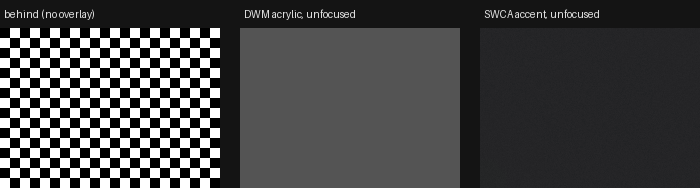
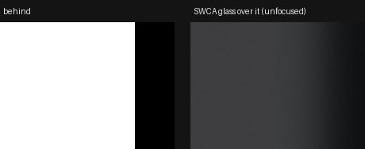

# Minmatar Fleet Overlay — Technology Confirmation

**Date:** 2026-10-16 · **Status:** core technology confirmed on Windows 11 25H2 (build 26200); one item still needs a real EVE client (see "Still to verify").

**Bottom line:** it's buildable, and the technology is proven. The overlay is a set of ordinary desktop windows composited *over* EVE by Windows itself. Nothing is injected into the game, nothing reads its memory, and nothing sends it input. That is the same model EVE Omni uses today and the only one that is safe under CCP's rules.

---

## 1. What "EVE Rift / EVE Omni" actually are

| | **RIFT** (Nohus Bluxome, riftforeve.online) | **EVE Omni** (Nareya79, MIT, github.com/Nareya79/eve-omni) |
|---|---|---|
| Form | Standalone intel/map desktop app (Win/Linux/macOS), EVE-themed UI, Neocom-style launcher | Desktop companion with **in-game overlays**: small see-through windows that float over EVE only while EVE is in front |
| Data | Intel chat logs, ESI, zKillboard | ESI + SSO (PKCE), chat logs, clipboard (Local paste), zKill, DOTLAN, EVE-Scout |
| Overlay tech | Not an overlay; normal app windows | **Electron** `BrowserWindow({ frame:false, transparent:true, focusable:false })` + `setAlwaysOnTop(true,'screen-saver')` + `setIgnoreMouseEvents(true,{forward:true})` |
| Active client | Logs + ESI | C# helper (compiled at runtime by PowerShell `Add-Type`) polls `GetForegroundWindow` every 50 ms, maps it to `exefile.exe`, and reads `EVE - <Character>` window titles via `EnumWindows` |
| Extras | — | `DwmRegisterThumbnail` (koffi → dwmapi.dll) for client previews; `WH_KEYBOARD_LL` hook for client cycling |

I read EVE Omni's source (`Programm-Quellcode/src/main.js`, `helfer.cs`) to confirm the mechanics above. I could not get RIFT's source (its GitLab returned 403), so its stack is not confirmed, and it isn't an overlay anyway.

**"Glass":** neither tool gives true frosted glass. EVE Omni's overlays are flat-transparent with per-window opacity. Real blur of the game behind the window is an extra step, confirmed below.

---

## 2. Fundamental #1 — Overlay the EVE client ✅ confirmed

**How:** each EVE-style window is its own top-level OS window with these properties:

| Property | API | Why |
|---|---|---|
| Frameless + per-pixel transparent | Electron `frame:false, transparent:true` | We draw the EVE chrome ourselves |
| Always above EVE | `setAlwaysOnTop(true,'screen-saver')` + re-raise ~300 ms after EVE takes focus | EVE coming to the front can land above the overlay for a frame (seen and fixed in testing) |
| Stay with EVE (default) | Not topmost; the helper's `stack` puts our windows directly above the EVE client with `SetWindowPos(…, SWP_NOACTIVATE)` on every focus change | Apps brought in front of EVE (Discord, a browser) cover the windows as they cover EVE. Only our windows move; EVE's are only read (`GetWindow`). Not an owned window of the client: that would tie our input queue to EVE's, so the app would freeze whenever EVE hitches |
| No native caption | `thickFrame:false`, and the helper strips `WS_CAPTION` | With the style left on, Windows painted its classic title bar over the page on header clicks and screenshots |
| Never steals focus | `focusable:false` → `WS_EX_NOACTIVATE`, `showInactive()` | Keyboard input stays in EVE |
| Click-through | `setIgnoreMouseEvents(true,{forward:true})`, switched off only while the cursor is over a control | Clicks pass into the game except on our buttons |
| Square corners | `DwmSetWindowAttribute(DWMWA_WINDOW_CORNER_PREFERENCE = DONOTROUND)` | Windows 11 rounds every top-level window; EVE windows are square |
| **Live glass blur** | `SetWindowCompositionAttribute(WCA_ACCENT_POLICY, ACCENT_ENABLE_ACRYLICBLURBEHIND)` | See below |

### The key finding: which blur API works

An overlay is **never the focused window**; EVE is. I tested both blur APIs on this PC with an unfocused, click-through window over a checkerboard ([glass_probe.ps1](evidence/glass_probe.ps1)):

- **Windows 11 system backdrop** (`DWMWA_SYSTEMBACKDROP_TYPE`, i.e. Electron's `backgroundMaterial:'acrylic'` and Tauri's `windowEffects:['acrylic']` on 22H2+) shows **flat grey once unfocused.** The blur is lost.
- **`SetWindowCompositionAttribute` accent blur keeps a live blur while unfocused.** Over a white/black edge it produces a smooth falloff, so it really is sampling what's behind it:

The setting is also applied **from a separate helper process** to Electron's windows. Verified in the prototype: `{"t":"glass","ok":true,"err":0,"cornerHr":0}` for every panel.

**Caveat:** `SetWindowCompositionAttribute` is undocumented. It has been stable from Windows 10 1809 through 11 25H2 and Windows Terminal-era apps rely on it, but keep the flat-transparent EVE Omni look as a runtime fallback.

### Display mode requirement

Overlays composite over **Window** and **Fixed Window** (borderless) modes. **True fullscreen** may bypass the compositor, in which case no external window can draw over it. Discord's overlay documents the same limit. This is the one item not yet tested against a real client.

---

## 3. Fundamental #2 — Understand the active EVE client in real time ✅ confirmed

Two independent real-time sources, joined by **character name**. No network needed.

### A. Which client is in front, and where (native helper)

[desktop/src/native/helper.cs](../../desktop/src/native/helper.cs) is event-driven, not polled:

- `SetWinEventHook(EVENT_SYSTEM_FOREGROUND)` fires the instant any window comes to the front. It's a client if the process is `exefile.exe` and the title is `EVE` (character select) or `EVE - <Character>`.
- `SetWinEventHook(EVENT_OBJECT_LOCATIONCHANGE / NAMECHANGE)` fires when a client moves, resizes, minimises or switches character.
- `GetClientRect` + `ClientToScreen` (per-monitor DPI aware) give exact client geometry, converted to Electron DIPs with `screen.screenToDipRect`, so it works on multiple monitors and mixed DPI.

Measured in the prototype: the overlay switched between two clients and hid when a non-EVE window came to the front. Every focus change in the diagnostic log landed within milliseconds of the event.

### B. What that character is doing (the client's own log files)

The exploration spike's log reader tails `Documents\EVE\logs` (follows the OneDrive redirect):

| File | Format | Gives you |
|---|---|---|
| `Chatlogs\Local_<date>_<time>_<charId>.txt` | UTF-16LE, header `Listener: <name>` | `EVE System > Channel changed to Local : <System>` → **current system**, on every jump/login |
| `Gamelogs\<date>_<time>_<charId>.txt` | UTF-8, header `Listener: <name>` | `(None) Jumping from A to B`, `(combat)`, `(notify)`, `(mining)`, `(bounty)` lines |

The file name carries the **character ID** and the header carries the **name**. Window title `EVE - Kaleb Snowden` → name → ID → portrait and ESI, all without a lookup call.

**Tested against real client logs:** 8 characters resolved with current system, last jump and last combat line. A full rescan over 3,806 gamelog files took **18 ms**. Tailing reopens the file every 250 ms and reads from the last offset. That stays reliable while EVE holds the file open, whereas directory change notifications go stale on NTFS for files that stay open.

### C. ESI (enrichment, not the real-time path)

`/characters/{id}/location`, `/ship` and `/online` are cached for seconds to a minute. Use ESI for ship type, fleet, skills and wallet, via the same SSO the site already uses. The site's FactionWarfare scope group already includes location. Don't use it for "where am I right now"; the logs are faster.

### Off the table (CCP rules / ban risk)

- **Memory reading** (Sanderling-style)
- **DLL injection / DirectX hooking into `exefile.exe`.** EveVision did this (Electron + injected overlay DLL). Its README quotes CCP's general overlay policy, but no CCP ruling on EveVision itself was found (see [ccp-third-party-guidelines.md](ccp-third-party-guidelines.md)). Injection is also fragile: it breaks with client updates and DX12.
- **Screen reading / OCR of the client**
- **Sending input to EVE.** EVE Omni's client-cycling hotkey only brings windows to the front.

CCP's 2016 overlay policy, still the published position: voice-style overlays are "not something we plan to actively police"; anything giving an unfair advantage, or using elements of *other* clients, can be actioned. Keep features informational: fleet and doctrine info, intel, timers.

---

## 4. Fundamental #3 — Look and feel exactly like EVE windows ✅ feasible, partially done

Measured against in-client Photon UI captures:

- **Chrome:** near-black translucent body over blurred space, 32 px header with icon + title (~14 px, light grey), `⋮ — ×` controls top-right, group rows in `rgba(255,255,255,.075)`, values right-aligned, red for damage taken, square corners, no drop shadow. All in [desktop/src/renderer/eve-window.css](../../desktop/src/renderer/eve-window.css).
- **Blur:** native (above), so it blurs the actual game the way EVE's own windows do.
- **Gaps to "exactly":**
  - **Font:** EVE uses CCP's *EVE Sans Neue*, which is CCP IP. The prototype falls back to Bahnschrift/Segoe UI. Ask CCP, or check the developer licence terms, before bundling it.
  - **UI scale:** EVE has its own UI scaling (90–150 %). Match it with a setting, or read it from the client settings later.
  - **Colour theme:** EVE lets each pilot pick a theme colour. Expose it as `--eve-accent` (prototype uses fleet red `#b53620`).
  - **Window behaviours:** drag-to-move with snapping, stacking/tabs, compact mode, pin. Not built yet.

---

## 5. Recommended stack

| Layer | Choice | Reason |
|---|---|---|
| Shell | **Electron** (spike pins 35.7.5) + TypeScript | Proven for exactly this by EVE Omni; HTML/CSS gives the best EVE fidelity; the fleet's devs already work in TS/Astro |
| Native | **C# sidecar** (spike: compiled at launch by `Add-Type`; ship as a .NET 8 NativeAOT exe), JSON lines over stdio | Win32 hooks belong in a language made for them; no native-module rebuild per Electron upgrade; testable alone. Alternative: `koffi` FFI in-process, as EVE Omni does for DWM |
| Data | Log tail (real time) + ESI via existing minmatar.org SSO (enrichment) | No game access needed |
| UI | One OS window per EVE-style panel; panel layout anchored to the active client's rect | Glass must be per OS window, because CSS `backdrop-filter` cannot see the game |

**Considered:** Tauri v2 is lighter (~10 MB vs ~100 MB) and works too, but its built-in acrylic hits the same unfocused-grey problem and it adds Rust. A pure .NET WPF/WinUI app is natively efficient but gives worse EVE-UI fidelity and is a stack the team doesn't use.

---

## 6. Still to verify (needs the real game)

1. EVE in **Fixed Window**: overlay stays above it, blur samples the 3D scene, z-order holds through alt-tab. *Expected to pass, same composition path as tested.*
2. EVE in **Fullscreen**: expected to fail (no overlay), so the app should say "switch to Fixed Window".
3. EVE's own **DX12 vs DX11** setting makes no difference to (1).
4. Latency of `Channel changed to Local` after a jump on a live client (should be under a second).

The packaged app in [desktop/](../../desktop/README.md) uses the overlay and active-client parts of this design. Log-file tailing is confirmed above but not wired into the app yet.

---

## Sources

- EVE Omni: [repo](https://github.com/Nareya79/eve-omni) · [site](https://omni.nareya79.com/)
- RIFT: [forum thread](https://forums.eveonline.com/t/rift-intel-fusion-tool-a-desktop-intel-and-map-app-for-windows-linux-and-macos/445556) · [site](https://riftforeve.online/)
- EveVision (injected overlay, for contrast): [repo](https://github.com/evevision/evevision)
- CCP policy: [Overlays, ISK Buyer Amnesty and Account Security](https://www.eveonline.com/news/view/overlays-isk-buyer-amnesty-and-account-security) · [Client modification, the EULA and you](https://www.eveonline.com/news/view/client-modification-the-eula-and-you)
- EVE-O Preview (view-only previews ruling): [repo](https://github.com/Phrynohyas/eve-o-preview)
- Discord overlay fullscreen limitation: [Discord support](https://support.discord.com/hc/en-us/articles/25289844838551--Known-Issue-Game-Overlay)
- Log locations: [EVE University – EVE logs](https://wiki.eveuniversity.org/EVE_logs)
