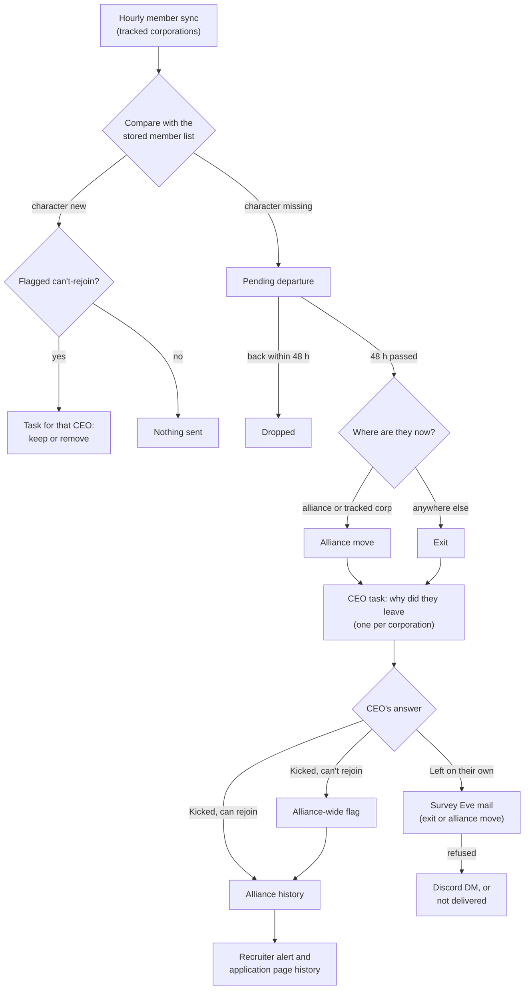

# Corporation exit flow: design

**Status:** built (all four parts, one pull request). Issue #3198. Author keldar-atm, reviewer bearthatcares, drafted
24 Nov 2026. The build plan is [exit-flow-plan.md](exit-flow-plan.md); its "design 04", "design 06" and so on
point at the numbered sections below.

When a pilot leaves a tracked corporation, the site notices, asks the CEO why, warns other corporations about
pilots who shouldn't come back, and sends people who left on their own one short survey that only the Alliance
Executor reads.

Each point is tagged with where it comes from:

- **[spec]** from the issue
- **[agreed]** decided while designing
- **[proposal]** a design call to check in review

The screens below are described as text, with their copy as it will appear. Names and numbers in them are
example data.

## 01 Decisions

Everything in the issue stands. These are the choices made on top of it while designing. All are **[agreed]**.

| Topic | Decision |
| --- | --- |
| Flagged pilot joins in game | Recruiters often invite in game, and the site then accepts the application by itself (`backend/applications/joined.py`), so the accept confirmation never shows. The member sync also spots joins: a flagged pilot appearing in a tracked corporation opens a task for that CEO: keep them (with a note) or remove them. |
| Survey can't be delivered | If ESI refuses the Eve mail (the pilot charges for mail from strangers), send the same text as a Discord DM when the pilot has a site account with Discord linked. Otherwise mark it "not delivered". |
| Where the CEO answers | A **Departures** tab on the corporation page, shown only to the CEO. The task links to it, and past answers stay findable and editable after the task closes. |
| History across corporations | Recruiters see every past departure from alliance corporations (reason, CEO, note), not only can't-rejoin flags, so a pilot hopping from corporation to corporation is visible. |
| Where recruiter alerts go | Never the application's Discord thread: the applicant is in it. A new recruiter-only alerts channel gets a short alert that pings the corporation's recruiter role and links the application. The details live on the application page, behind the recruiter check. |
| Alert volume | At most one alert per application. Alerts only for a can't-rejoin flag or "kicked for another reason". Later answers re-alert only when they add a can't-rejoin flag. No history, no alert. |
| Code layout | Exit surveys go in the existing `surveys` app (as the issue asks), with their own invite and response tables. Everything else goes in a new `exits` app. See below. |

### Why the surveys get their own tables inside `surveys`

The issue says to build the surveys in the `surveys` app "if it fits". Most of it fits: question definitions
written in code (`surveys.definitions`), typed answer columns, and the `SurveyField` component. The response table
doesn't: `SurveyResponse.user` is required, and each campaign is one per quarter (`unique_survey_per_quarter`).
Exit surveys go to pilots with no site account, continuously. So the two exit definitions sit next to the
community survey, and their invites and responses get their own tables in the same app. The quarterly tables,
their aggregation and their rules don't change.

The other options considered: putting everything in a new app, ignoring the issue's direction; changing
`SurveyResponse` and the campaign rules, which risks the community survey's results; or spreading the feature over
`eveonline`, `applications` and `surveys`, with no clear owner and data split for the Executor's queries.

## 02 The whole flow

One hourly member sync feeds everything. The 48-hour grace period and the CEO's answer are the two gates before
anything leaves the site.

## 03 Spotting departures

### What gets tracked

- A **Track exits** checkbox on `EveCorporation` (`track_exits`, off by default), set in the admin. On for alliance
  member corporations and exceptions like Minmatar Extraction Company, off for associate alt corporations.
  **[spec]**
- The member sync (`update_corporation_members_and_roles`) runs for every tracked corporation, whatever its type.
  Today it only runs for alliance and associate corporations. **[proposal]**

### Comparing member lists

- Each successful sync of a tracked corporation stores its member list (one row per corporation) and compares it
  with the previous one. **[spec]**
- **A failed or empty ESI read is not "everyone left".** If the members call fails or returns an empty list, the
  comparison is skipped and logged, and the stored list is kept. A real mass kick (40 of 60) is still recorded:
  the grace period and the destination check below handle it. **[proposal]**
- The first sync after tracking starts only stores the list. Unchecking Track exits drops pending departures and
  deletes the stored list, so turning it back on starts fresh. **[spec]**
- If the corporation's own alliance changed since the last sync (the whole corporation left), the stored list is
  reset and its pending departures are dropped. **[spec]**

### The 48 hours, and where they went

- A missing character gets a pending departure: character ID, corporation, first seen missing. It works for pilots
  with no site account, since the sync creates an `EveCharacter` for every member already. **[spec]**
- Back in the same corporation within 48 hours: the departure is dropped. **[spec]**
- After 48 hours the destination comes from the 15-minute affiliation sync (`update_character_affilliations`
  already covers every known character), so no extra ESI calls are made. An alliance corporation or another
  tracked corporation means an **alliance move**; anything else is an **exit**. The destination is frozen on the
  departure. NPC corporations (IDs 1000000–1999999) are tagged so the CEO sees "NPC corp", the usual sign of a
  kick. **[proposal]**
- If the character no longer resolves on ESI (biomassed), the destination is unknown: it counts as an exit, and no
  survey is sent. **[proposal]**

### Joins

- The same comparison sees characters who are new on the list. If a new member, or any character on their
  account, has a can't-rejoin flag, a task opens for that corporation's CEO (see 06). Joins without a flag create
  nothing. **[agreed]**

## 04 The CEO's Departures tab

A task-board rule (`exit_departures`, CEO audience) collects one item per tracked corporation that has confirmed
departures without an answer: "Tell us why 12 pilots left". It links to `/alliance/corporations/<id>/#departures`.
New departures join the open task, and the task closes by itself on the next sync once every row is answered,
which is how task-board rules already work (`taskboard.sync`). **[spec]**

### Screen: corporation page, Departures tab (CEO only)

Tabs: About · Activity · Leadership · Members · **Departures** · Settings

> **12 pilots left Example Corp**
>
> Seen leaving between 2 Nov and 22 Nov. Tell us why, so kicks for inactivity and pilots who chose to go don't look
> the same.

Notice box (amber), copy as written:

> **Who sees your answers:** your reason and note are shown to recruiters of any alliance corporation this pilot
> applies to or joins, so write them for another CEO to read. Pilots never see them. Survey answers from pilots go
> only to the Alliance Executor.

Filter chips: **Needs an answer · 9** (selected) · Answered · 3 · All · 12, and a progress bar "3 of 12 answered".

Bulk bar, shown when rows are ticked: "**4 selected** · Set for all: [Kicked: inactive | Kicked: other | Left on
their own] · Can rejoin [Yes | No] · **Save 4** · Clear".

| ☐ | Pilot | Seen leaving | Went to | Reason | Can rejoin | Note |
| --- | --- | --- | --- | --- | --- | --- |
| ☑ | **Arkan Veld** — Registered · 14 months in corp | 20 Nov (4 days ago) | Pator Tech School `NPC corp` | set by the bar above | | |
| ☑ | **Mira Stonehand** — Not on the site | 20 Nov (4 days ago) | Republic University `NPC corp` | set by the bar above | | |
| ☑ | **Toren Ashblade** + 2 alts — Registered · one answer covers the account | 18 Nov | Brave Newbies Inc. `Exit` | set by the bar above | | |
| ☐ | **Kesh Varo** — Registered · 3 months in corp | 15 Nov | Tribal Liberation Force `Alliance move` | **Left** | — | (optional) |
| ☐ | **Dren Halvik** — Registered · 6 weeks in corp | 9 Nov | Pator Tech School `NPC corp` | **Kicked: other** | **No** | Awoxed a corp Orca |
| | **Lyss Corran** | 4 Nov | Sebiestor Tribe `NPC corp` | ✓ Left on their own · survey sent 6 Nov | | |

### How it behaves

- **Bulk first.** Tick rows, pick a reason once, save: 40 inactive kicks is one action. Rows can also be answered
  one by one. **[spec]**
- **Reasons:** kicked for inactivity · kicked for another reason · left on their own. **Can rejoin** shows only for
  kicks. Note optional, except for "can't rejoin", where it's required (06). **[spec]** **[proposal]**
- **Alts collapse into one row** when they're on the same registered account and left within the same 48 hours, so
  the CEO answers once per person. The answer is stored on every departure in the group. **[proposal]**
- **"Went to"** with Exit / Alliance move / NPC corp tags is the hint a CEO needs. There's no activity data, as the
  spec says. Time in corp comes from the public corporation history the site already stores
  (`EveCharacterCorporationHistory`); drop it if it counts as activity data. **[proposal]**
- **An hour to undo.** "Left on their own" sends the survey an hour after saving, not straight away, so a misclick
  can be fixed before an Eve mail goes out. After the survey is sent, the reason locks (it chose the survey). The
  rejoin flag and note stay editable. **[proposal]**
- **Filters:** Needs an answer (the default while the task is open), Answered, All. With nothing left to answer,
  the tab shows the answered list and an empty state for the queue. **[proposal]**
- **Built from Rust:** the table, checkboxes, segmented choice, `Input`, `Badge`/`Tag`, `EmptyState`, confirm
  dialog. Saving posts to an htmx partial that re-renders the table. The table scrolls inside `XFadeScroll` at
  390px. **[proposal]**

## 05 Director token task

This already exists. The task-board rule `corp_director_token` opens "Add a director token" (or "Update the
director token") for alliance corporations whose director token is missing or lacks scopes, links to the Members
tab, and closes once a token works. The issue's requirement 3 becomes: run that rule for every tracked corporation
too, so Minmatar Extraction Company and other tracked exceptions are covered. Its detail line gains "Departures
can't be tracked without it" when the corporation is tracked. **[proposal]**

## 06 Can't-rejoin flags and alliance history

Every CEO answer becomes part of the pilot's **alliance history**. A "can rejoin: no" answer also sets a **flag**,
the strongest entry. Both are stored by character ID and cover every character on a registered account, including
alts added later. **[spec]** **[agreed]**

### Screen 1: the CEO sets a flag (confirm dialog)

> **Mark Dren Halvik as can't rejoin?**
>
> Recruiters in **every** alliance corporation will see this when Dren, or any character on Dren's account, applies
> or joins:
>
> - that you set it, and when
> - the reason: **kicked for another reason**
> - your note
>
> Note: *Awoxed a corp Orca*
>
> A note is required. You can clear the flag later from the Departures tab.
>
> [Cancel] [**Mark can't rejoin**] (red)

### Screen 2: recruiter alerts channel (Discord)

> **Minmatar Fleet** `APP`
>
> @Other Corp Recruiters
>
> **⚠ Dren Halvik, applying to Other Corp, has alliance history**
> Includes a **can't-rejoin** flag from Example Corp.
> [Open the application]
> *Details are on the application page. The applicant can't see this channel.*

### Screen 3: application page, Alliance history panel (recruiters only)

> **Alliance history**
>
> `Can't rejoin` **Example Corp** · 9 Nov
> Kicked for another reason · Arkan Veld (CEO): "Awoxed a corp Orca"
>
> `Inactive kick` **Second Corp** · 2 Sep
> Can rejoin · Sela Morn (CEO): "Gone 3 months, no word"
>
> `Left` **Third Corp** · 14 May

Pressing Accept on a flagged applicant opens:

> **Accept a pilot marked can't rejoin?**
>
> Arkan Veld (Example Corp) marked Dren Halvik as not allowed to rejoin on 9 Nov: "Awoxed a corp Orca".
>
> [Cancel] [**Accept anyway**]
>
> *Accepting anyway is recorded (who, when). The flag stays.*

### Screen 4: joined through an in-game invite (task for that corporation's CEO)

> **Dren Halvik joined Other Corp. They're marked can't rejoin**
> Arkan Veld (Example Corp), 9 Nov: "Awoxed a corp Orca"
>
> [**Keep them…**] [I'll remove them]

"Keep them" asks for a short note and closes the task; the flag stays for other corporations. "I'll remove them"
closes once the next sync no longer lists them.

### Rules

- **Never in the applicant's thread.** The application's Discord thread mentions the applicant
  (`application_starter_message`), so they're in it. Alerts go to a new recruiter-only channel
  (`DISCORD_RECRUITER_ALERTS_CHANNEL_ID`; ops sets its permissions to the recruiter roles). **[agreed]**
- **Each alert** pings the recruiter role of the corporation applied to (`_recruiter_role_mention`) and links that
  application (`application_url`). Recruiters from other corporations who share the channel see only that history
  exists, not what it says. **[agreed]**
- **Volume:** at most one alert per application, posted when it opens and never edited. Only for a can't-rejoin flag
  or "kicked for another reason"; inactivity kicks and voluntary leavers appear only on the application page. A CEO
  answer that adds a can't-rejoin flag while the pilot has open applications alerts each of them once. A transfer
  counts as a new application for the receiving corporation. **[agreed]**
- **Application page:** the history panel renders only for users who pass `can_review_applications` for that
  corporation. The applicant can open their own application page, so it must not leak there. **[agreed]**
- **Accept on the site:** if the applicant is flagged, the accept endpoint answers 409 with the flags unless the
  request confirms them. The page shows the confirm dialog and resends. The confirmation is stored (who, when,
  which flags). **[spec]**
- **Several flags** from different corporations can stack, and recruiters see all of them, newest first.
  **[proposal]**
- **Clearing a flag:** the current CEO of the corporation that set it (from its Departures tab, so a CEO change
  doesn't orphan it) and admins. Every clear is recorded. The issue only mentions the admin; the tab makes
  self-correction possible. **[proposal]**
- **Members tab:** members with alliance history get a small History tag that opens the same list, for the
  corporation's CEO and directors. No task opens for joins without a flag. **[proposal]**
- Pilots never see a flag or their history, and nothing changes in their application flow. **[spec]**

## 07 Surveys

Exit and alliance move surveys are two new definitions in `surveys.definitions`, next to the community survey.
Their questions are the issue's drafts, unchanged.

### Screen: the Eve mail (from the Executor's mail character)

> **From:** BearThatCares (Alliance Executor) · **Subject:** You left Example Corp. How was it?
>
> o7 Kesh,
>
> You left Example Corp on 15 Nov. Fair winds wherever you fly next.
>
> We'd like to know how your time there went, good or bad. It takes about three minutes, and only I read the
> answers: your old CEO and directors never see them.
>
> [Answer the survey] (no login needed, open for 30 days)
>
> Thanks,
> BearThatCares, Minmatar Fleet Alliance

### Screen: the survey page, `/exit-survey/<token>/` (no nav, not indexed)

> **Your time in Example Corp**
> Kesh Varo · member from Aug to 15 Nov
>
> *Only the Minmatar Fleet Alliance Executor reads these answers. Example Corp's CEO and directors never see them,
> not even as totals.*
>
> 1. **Overall, how much did you enjoy Example Corp?** 1–5, "Not at all" to "A lot"
> 2. **Leadership · Activity and content · Feeling welcome**: 1–5 each
> 3. **Why did you leave?** Pick any that fit: I was inactive in EVE · Corp was inactive · Leadership issues ·
>    Timezone · Different content · Friends elsewhere · Quitting EVE · Other
> 4. **A problem we should know about?** (optional text)
>
> [**Send answers**] *Only the ratings are required.*

### Sending

- **Which survey:** exit + left on their own → exit survey; alliance move + left on their own → alliance move
  survey (the same ratings for the corporation they left, then "why did you move" and "how was onboarding in
  &lt;new corp&gt;"). Kicks get no survey. **[spec]**
- **When:** once the grace period has passed, the CEO has answered, and the hour to undo is over. **[spec]**
  **[proposal]**
- **Delivery:** Eve mail from `NOTIFICATIONS_EVE_MAIL_CHARACTER_ID` straight to the departed character's ID. Today
  `_send_eve_mail` takes a user and mails their main, so a lower-level "mail this character" helper is split out of
  it, keeping its rate bucket. **[spec]**
- **Refused mail:** if ESI refuses it (a CSPA charge) and the character is on an account with Discord linked, the
  same text goes as a Discord DM through the notifications Discord adapter. Otherwise the invite is marked "not
  delivered". Transient ESI errors retry as notifications already do. **[agreed]**
- **Which character, for an account:** alts that left together get one survey, addressed to the account's main if
  it's among them, otherwise the first character that left. **[proposal]**
- **One survey per person, ever:** no second invite for any character on the same account; one per character when
  the account is unknown. Exit and alliance move surveys share the limit. **[spec]**

### The link and the page

- A signed token (Django `signing`, its own salt, the pattern from `backend/fleets/helpers/invite_rsvp.py`)
  carrying the invite ID. It expires after 30 days and works once: the invite records `responded_at`. **[spec]**
- The page follows the fleet RSVP page: `GuestsViewport`, `noindex`, no analytics, `Cache-Control: no-store`,
  `Referrer-Policy: no-referrer`. Questions render with `SurveyField`; the answers post to an htmx partial.
  **[proposal]**
- Only the four ratings are required. The rest is optional, so the survey stays quick. **[proposal]**
- After sending: "Thanks, that's sent", with a link to the alliance's corporation list. A used or expired link
  shows a plain "This link has already been used or has expired" and nothing about the survey or the corporation.
  **[proposal]**

## 08 Who sees what

| Data | Who sees it | Where |
| --- | --- | --- |
| Departures and CEO answers | The corporation's CEO | Departures tab |
| Alliance history and flags | Recruiters of a corporation the pilot applies to; CEO and directors of a corporation they're in | Application page, Members tab History tag, the join task |
| That history exists | Recruiters in the alerts channel | One alert per application, as limited above |
| Survey answers | The Alliance Executor only, never the corporation's CEO or directors, even as totals | No UI: the read-only production DB / Metabase, and the Django admin limited to the Executor |
| Anything at all | Never the pilot | — |

Everything the Executor counts is typed, not free text: departures per corporation per month, the inactive-kick
vs. voluntary split, survey delivery and response rates, ratings by corporation and survey version. Every survey
answer row carries the corporation ID and the definition version, so no joins through free text are needed.
**[spec]**

## 09 Data model

New tables, all additive. One new column on an existing table. Names are proposals.

| Table | App | Holds |
| --- | --- | --- |
| `EveCorporation.track_exits` | eveonline | Boolean, default off. The admin checkbox. |
| `MemberSnapshot` | exits | One row per tracked corporation: member character IDs (JSON), alliance ID at the time, taken at. |
| `Departure` | exits | Corporation, character ID, account (when known), first seen missing, status (pending · dropped · confirmed), confirmed at, destination corporation ID, kind (exit · alliance move), NPC destination flag, reason, can rejoin, note, answered by, answered at, survey due at. |
| `RejoinFlag` | exits | Character ID, account (when known), departure, corporation, set by, set at, cleared by, cleared at. |
| `FlaggedJoin` | exits | A flagged pilot appearing in a tracked corporation: corporation, character, flags at the time, outcome (kept with note · removed), resolved by and at. Drives the join task. |
| `RecruiterAlert` | exits | Application, reason (flag · other kick), sent at, Discord message ID. One per application and reason, which enforces the volume rules. |
| `FlagAcceptance` | exits | Application, flags confirmed, accepted by, accepted at. |
| `ExitSurveyInvite` | surveys | Departure, character ID, account (when known), definition key and version, channel (Eve mail · Discord DM), status (sent · not delivered), sent at, expires at, responded at. |
| `ExitSurveyResponse` and `ExitSurveyAnswer` | surveys | One response per invite (corporation ID, definition key and version, submitted at), and typed answers per question key (numeric, choice, multi as JSON, text), the same columns as `SurveyAnswer`. |

Tasks need no new tables: new task-board rules (`exit_departures`, `exit_flagged_join`) collect their items from
these tables, plus a change to `corp_director_token`. For a CEO-only audience the rules use a new corporation
`team_role` ("ceo"), which `taskboard.teams` resolves to the corporation's CEO. The `team_kind`/`team_id` fields
stay, so directors can be added later by changing only the role. **[proposal]**

## 10 Edge cases

| Case | What happens |
| --- | --- |
| ESI members call fails, or returns empty | No comparison; the stored list is kept; logged. |
| Director token lost | Syncs stop, so no departures; the director token task opens. When a sync works again, it compares with the last stored list, so departures in between are caught, with a later "first seen missing". |
| Left and came back after 48 hours | The departure stays (they did leave). If they're flagged and come back to a tracked corporation, the join task opens. |
| Moved to another tracked corporation within 48 hours | An alliance move after the grace period; the old CEO is still asked; "left on their own" sends the alliance move survey. |
| Whole corporation leaves the alliance | Its alliance changed since the last sync: the stored list is reset, pending departures are dropped, nothing is created. |
| CEO changes while a task is open | The task follows the corporation's CEO (team task), so the new CEO gets it. |
| Character biomassed | Destination unknown, counted as an exit, no survey. |
| Pilot registers after leaving | Departures are keyed by character ID; the account is filled in when the character is linked, so the survey limit and flag coverage catch up. |
| A flagged pilot's new alt, not on the site | Can't be linked to the flag. A known limit; the CEO's note is the safeguard. |
| Survey link forwarded to someone else | Works once, within 30 days; the answer is tied to the invite, not the reader. Accepted risk for a no-login link. |

## 11 Build plan

Four pull requests, each from a fresh `main`, backend before website, each one usable on its own. The tasks,
interfaces and tests are in [exit-flow-plan.md](exit-flow-plan.md).

1. **Departures, backend.** `track_exits`, the `exits` app, snapshots, comparison, grace period, destination, the
   corporation-leaves case, the `corp_director_token` change.
2. **CEO answers.** The `exit_departures` rule, the API for listing and answering (bulk), flags, and the
   Departures tab with its partial.
3. **Flags in the application flow.** Alliance history API, the alerts channel, the application page panel, the
   accept confirmation, flagged joins and their task, the Members tab tag.
4. **Surveys.** The two definitions, invites, the "mail this character" helper with the Discord fallback, the
   token page, responses, and the Executor-only admin.

Each one ends with a real run on the local stack (a test corporation, a dev Discord server) before its pull
request opens.

## 12 Open questions for review

1. **Executor only, exactly:** is it enough that the survey tables have no API and their admin pages open only for
   the Executor's account, with read access otherwise through Metabase? Or should other superusers be kept out of
   the admin too? (Proposal: the Executor's account only, by `ALLIANCE_EXECUTOR_CHARACTER_ID`.)
2. **Time in corp on the Departures tab:** keep it, or does it count as the "activity data" the issue leaves out?
3. **Clearing flags:** fine for the setting corporation's current CEO to clear their own, or admins only, as the
   issue says?
4. **Mail sender:** the survey mails come from the Executor's own character. Should replies go there, or should the
   mail say not to reply?
5. **Survey wording:** the questions are the issue's drafts as written. Any changes before they're fixed in a
   versioned definition?

Out of scope, as the issue says: reminders or escalation for unanswered CEO tasks, any results UI, and a CEO view
of feedback.
