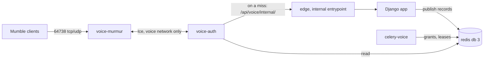

# Fleet voice on Mumble

Fleets talk on Discord by default. An FC can pick **Mumble** as a fleet's voice when scheduling; that fleet then gets a channel branch on one alliance Mumble server (`voice.minmatar.org`), and its MOTD links `my.minmatar.org/voice`. For a Discord option the FC picks a voice channel on that server instead (see [Discord voice channels](#discord-voice-channels)). Design and decisions: issue #3154. The old, removed stack is in [archive/mumble-removed-stack.md](archive/mumble-removed-stack.md).

**Django decides, the voice service obeys.** Every access rule lives in `backend/voice/access.py`. The voice service (`voice/`) only reads the records Django publishes to Redis and applies them to Murmur over Ice.

## Going live

The Mumble voice option (`FleetVoiceOption`, kind `mumble`) is created **inactive** by `fleets/migrations/0069_seed_voice_options.py`, so nothing changes for pilots until ops switches it on in the admin. Before that: the host steps in the private runbook (nginx block and certbot certificate for `voice.minmatar.org`, network protection for port 64738), the secrets in `.env` (see `.env.example`), and removing any old voice stack. `voice.tasks.heartbeat_check` stays quiet until the option is active.

## Who can connect

Worked out on read (`voice_record(character_id)`), never stored:

| Access | Source | Gives |
|---|---|---|
| Community | feature `voice.join` (Alliance, Associate) | Lobby, Open 1-2, and Fleet 1's subchannels (not its Command), with or without a fleet |
| Fleet commander | feature `voice.commander` (`pulse.fleet-commanders`) | Commanders in every Mumble fleet branch |
| Capitals on standby | active member of any active group of tribe `capitals` | `capitals` in every branch |
| Campaign ally | a character, corporation or alliance listed as an ally of the fleet's active campaign (factions never count) | that fleet's branch |
| Voice admin | feature `voice.admin` (superusers) or a Strategic FC | `voiceadmin`: move, mute, kick anywhere |
| Ban | `VoiceBan` | refuses everything; checked first |

**Main only.** A character on a site account connects only when it is that account's main (`voice.access`): an alt is refused (`reason: not_main`) even through the guest sign-in, and fleet grants earned on an alt (in the in-game fleet, volunteering, boss) go to the main. Characters with no site account count as their own main.

Stored as `VoiceGrant` rows (`backend/voice/grants.py`), so logins never join fleet tables: pilots in the in-game fleet (logistics hull and wing noted for placement), volunteers, invitees who said in (except low confidence), the fleet's creator and in-game boss (with their alts) as commanders, co-FCs added on the fleet page, and capital hulls flown or volunteered by trusted pilots. Each sync also expires the grants of pilots who backed out (withdrew, answered Out or low confidence, left the in-game fleet); co-FC grants are only changed on the fleet page. Grants all end with the fleet's lease. A kick lasts for the rest of the lease.

## Leases

Three branches (`Fleet 1`-`Fleet 3`) always exist. **Fleet 1 is open**: any community member may enter its subchannels (`OPEN_BRANCH` in `backend/voice/channels.py` and `voice/voice_auth/layout.py`, pinned by `channels.json`). On the fleet form the FC picks **Fleet 1 · Open** (`EveFleet.mumble_open`) or **Fleet 2 or 3 · Restricted**. An open fleet leases Fleet 1, or a restricted branch when another open fleet holds it; a restricted fleet leases only Fleet 2 or 3, and a fleet switched to restricted gives Fleet 1 up (`access_changed`). `backend/voice/leases.py`: a Mumble fleet leases a free branch when tracking starts, or from 2 hours before start once it has signups. With no tracking 30 minutes after start, or 30 minutes after it closes, or when the FC switches voice away from Mumble, the lease ends; the voice service kicks whoever is left and resets the branch. `voice.tasks.expire_grants` runs every minute; the 30-second fleet poll queues `voice.tasks.sync_fleet_grants` for Mumble fleets only.

## Discord voice channels

A Discord option (`FleetVoiceOption`, kind `discord`) names its server in `discord_guild_id` and the channel the form starts on in `discord_channel_id` (set both in the admin; migration `fleets/0070` points the alliance Discord option at `DISCORD_GUILD_ID`). `GET /api/fleets/voice-options` lists each option's voice and stage channels from Discord, grouped by category and cached 5 minutes per server (`fleets/helpers/voice_channels.py`). A channel @everyone can't see or join is left out, and so is one with `hide_from_fleets` on its `DiscordChannel` row (admin: Discord channels). The fleet stores the pick (`voice_channel_id`, `voice_channel_name`). The start ping's VOICE CHANNEL line is a channel mention on the alliance server and a link for another server (Discord can't show a mention across servers), and Join Voice Channel opens it; the MOTD's Voice line links it. With Discord unreachable the form lists no channels and the fleet keeps the server's invite link.

## Signing in

- `/voice` (`frontend/app/src/pages/voice.astro`) has no gate. Site members use their own session and connect as their main. Guests sign in with EVE: `/voice/sign-in` sets a random state in a short-lived cookie and sends the browser to `GET /api/voice/login` (`publicData` only, no site account), and `/voice/login` keeps the returned token only when its state matches the cookie; `backend/voice/views.py` completes it, stores a `VoiceIdentity` (with the owner hash) and keeps no ESI token. The browser gets a voice JWT (`aud: voice`, 30 days) in an HttpOnly `voice_session` cookie. A changed owner hash (character sold) revokes certificates and grants.
- **Signed out**, `/voice` is one screen over the fleet cover art (`VoiceBackdrop`: dark wash, gold grid, comms waveform): the headline, the setup bar (`VoiceProgress`: Sign in, Access, Install, Connect, Keys) at Sign in, and one action, "Sign in with EVE" (public scopes only). There is no site-login link: a site member who is logged in never sees this screen, and the guest sign-in works for members too. The setup flow below moves the same `VoiceProgress` bar with Alpine.
- **The page shows one step at a time**, picked from `/api/voice/status` in `frontend/app/src/pages/partials/voice_status_component.astro` (`voice_step` in `helpers/voice_session.ts`). Refusals first (banned, `not_main` with a one-click switch through `/voice/sign-in?switch=1`, no fleet yet with a 30-second re-check), then a first-time setup while `certificate_count` is 0 (device, install, what to click in Mumble's first-launch wizards, Connect), then just Connect. The status names each fleet the pilot can join (`fleet_title`, `start_time`, `fc_name`). Connect opens the `mumble://` link at once; `voice_connected_component` then watches the certificates for 150 seconds and, when one is bound or used after the click, the page shows the key guide (role-specific: commanders get Broadcast). A browser that has connected gets a `voice_returning` cookie (no token in it), so when its voice sign-in lapses `/voice` offers "Sign in and connect" (`/voice/sign-in?then=connect`), which comes back to `/voice?connect=1` and opens Mumble without another click.
- **Connect** (`POST /api/voice/connect`) mints a one-time token (hashed, 2 minutes) inside a `mumble://` link. The first login binds the client certificate; later logins use it. An empty certificate hash is never bound or matched. Up to 3 certificates per character, removable on `/voice`. A certificate bound to the account's old main moves to the new main on its first Connect; one bound to another account is refused.
- The Mumble user id is the `VoiceIdentity` id. Display name `[TICKER] Character`. `SuperUser` is always refused.
- **Fail closed**: Murmur has a long random server password nobody is told. With the voice service down, nobody gets in (lab-verified, `voice/tests/lab/fail_closed.py`).

## Redis contract

Written by `backend/voice/publisher.py`, read by `voice/voice_auth/records.py`, pinned by `voice/tests/contracts/*.json` (regenerate with `UPDATE_CONTRACTS=1` from `backend/voice/tests/test_publisher.py`; keep changes additive).

| Key | Value |
|---|---|
| `voice:char:<character_id>` | the record: admitted, banned, display name, server groups, per-branch groups and placement, preferred branch |
| `voice:identity:<id>` | character id |
| `voice:cert:<hash>` | identity id |
| `voice:leases` | branch -> lease id, fleet id, wing channels |
| `voice:changed` | pub/sub: a character id, `leases` or `commands` |
| `voice:commands` | list of website kicks |
| `voice:heartbeat` | written by the voice service; watched by `voice.tasks.heartbeat_check` |

`voice.tasks.rebuild_records` republishes everything hourly, and `expire_grants` rebuilds when Redis lost records. `manage.py voice_status [--rebuild]` shows leases and the heartbeat.

## The server

- Channels and ACLs: `voice/voice_auth/layout.py`. Root, Lobby (default channel), Open 1-2, and per branch: Command at the top, Mainline, Logistics, Auxiliary A-C below. Fleet 1 also lets the `community` group traverse Command and enter its subchannels; the reconciler leaves community members there without a lease (and moves them out of Command). ACLs are applied when voice-auth starts, so an ACL change needs voice-auth restarted. Text is off; nobody gets `Ban` or `Write` (Ban shows IP addresses). Commanders are priority speakers.
- Placement (`voice/voice_auth/reconcile.py`): once per lease, by role (Command, Logistics, the FC's wing mapping, else Mainline); reconnects return to the last channel; a pilot's own moves are never overridden and nobody is pulled out of an Open channel or another fleet's branch.
- Compose (`docker-compose-prod.yml`): `voice-murmur` (pinned image, settings as `MUMBLE_CONFIG_*`), `voice-auth` (built from `voice/`), `celery-voice`. The `voice` network is internal and carries only Ice. `/api/voice/internal/` is served only on the edge's `internal` entrypoint (no host port) and checks `VOICE_INTERNAL_SECRET`. Ordinary deploys don't recreate the voice services.
- Hangs: calls into Murmur time out after 10 s, login decisions after 5 s, and a watchdog exits voice-auth when its main loop stalls for a minute so `restart: always` brings it back (`voice/README.md`, "When Murmur stops answering").
- Tests: `voice/tests/test_service.py` (fake Murmur) and the real-Murmur lab, `voice/tests/lab/run.sh`, both in the `voice-check` CI job.
